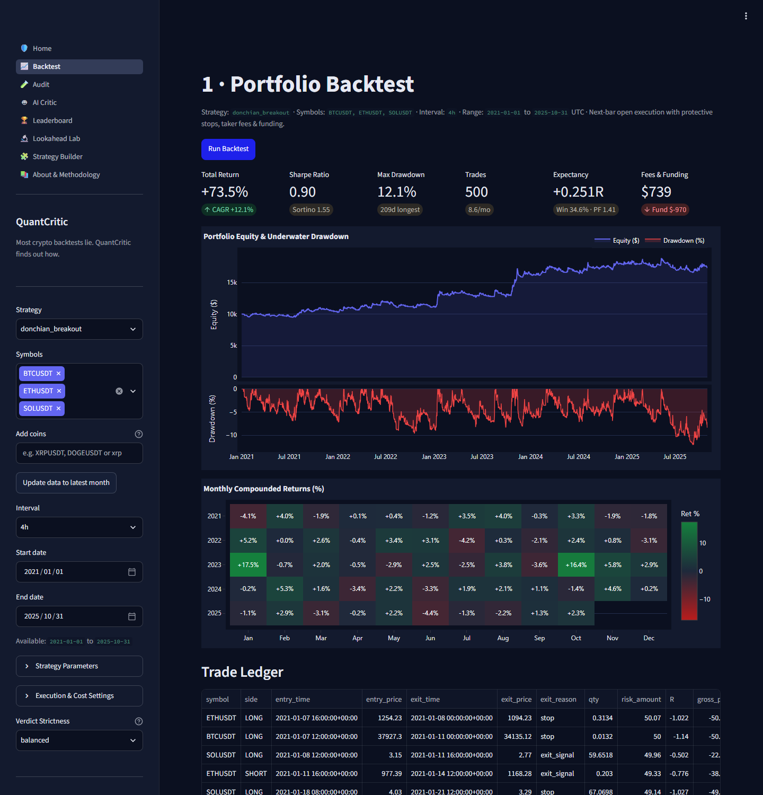
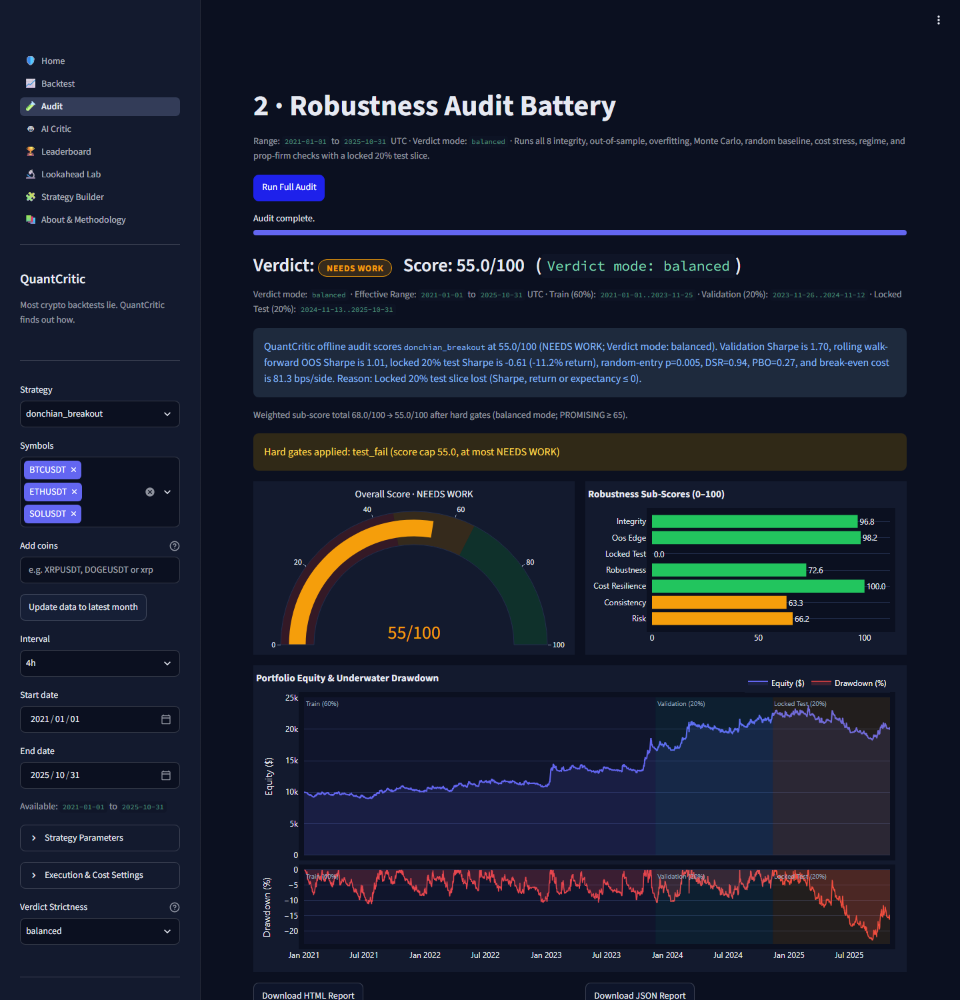
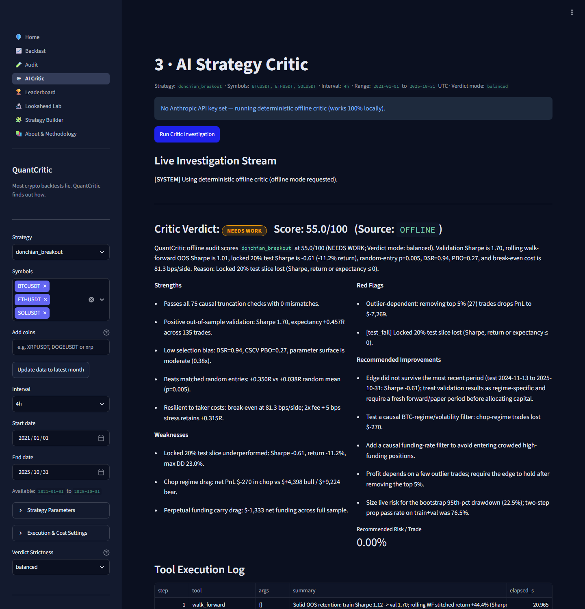
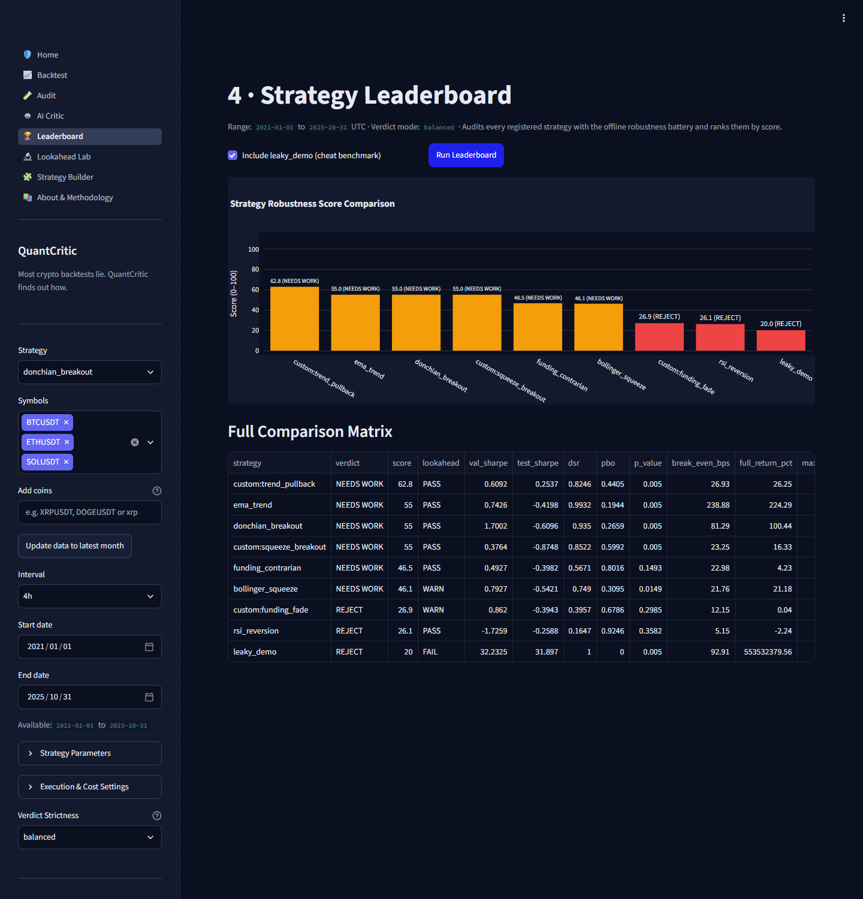
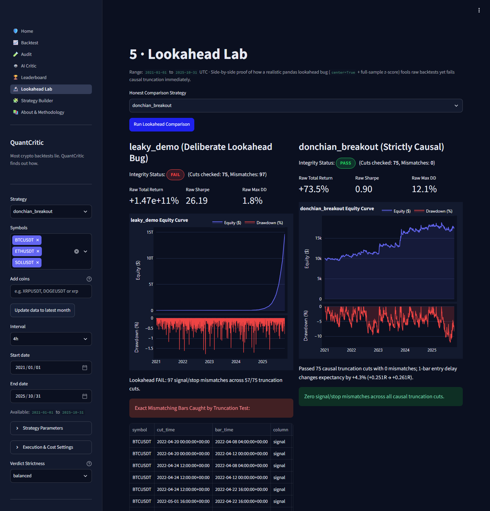
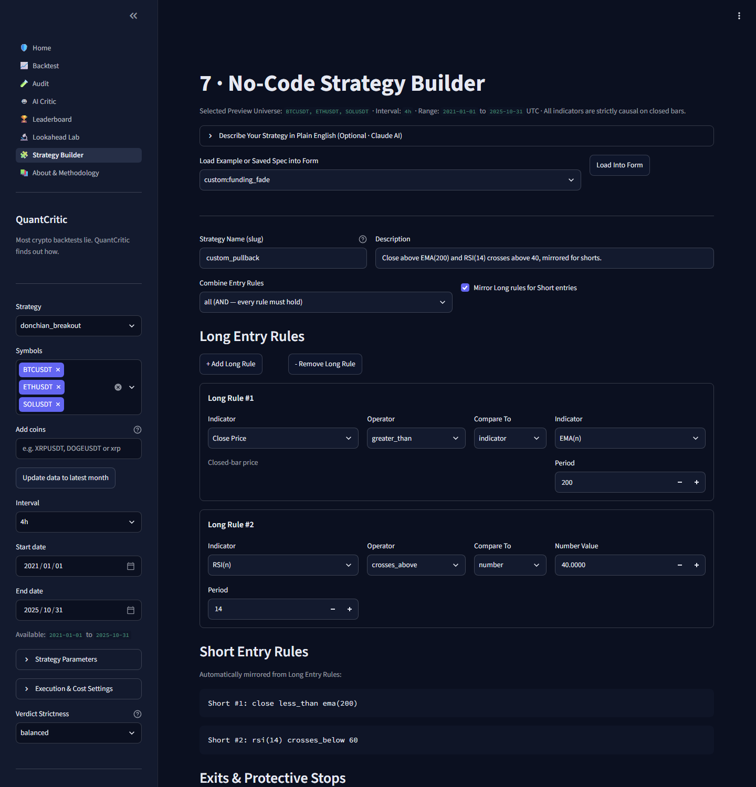
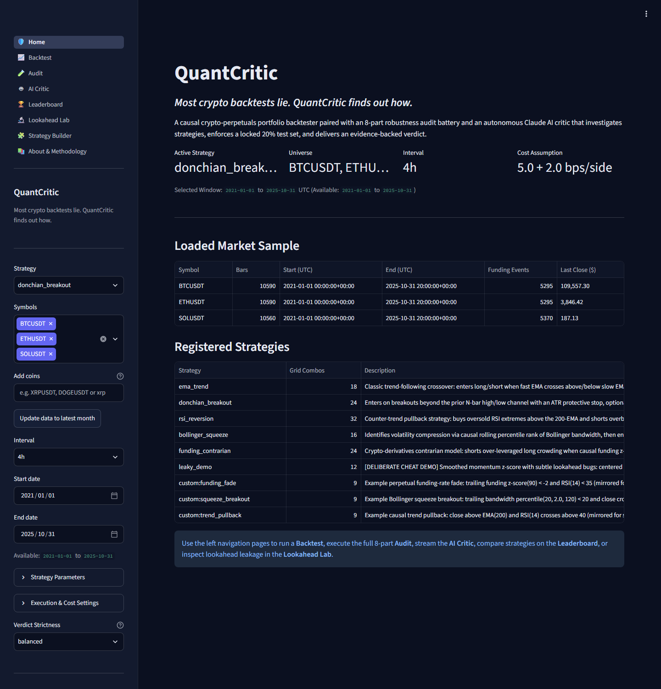
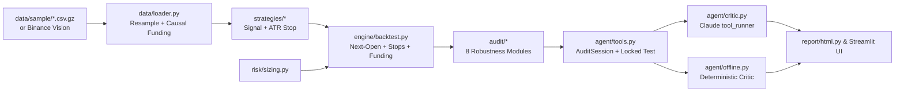

# QuantCritic

> **Most crypto backtests lie. QuantCritic finds out how.**

QuantCritic is an open-source crypto-perpetuals backtesting engine, statistical robustness audit suite, and autonomous AI strategy critic built in Python. Instead of trusting a single headline Sharpe ratio, QuantCritic subjects trading strategies to causal lookahead truncation checks, chronological walk-forward validation, Deflated Sharpe Ratio & CSCV Probability of Backtest Overfitting, vectorized random-entry permutation baselines, fee/slippage stress matrices, regime consistency checks, and rolling two-step prop-firm simulations—all behind a strictly locked held-out test set.

---

## Screenshots

Real screenshots of the running app (headless Chromium, default settings, no API key).


<sub>Backtest: equity, drawdown, monthly heatmap, full trade ledger with fees and funding</sub>

| | |
|---|---|
| <br><sub>Audit: 0-100 score, verdict, hard gates, train / validation / locked-test split</sub> | <br><sub>AI Critic: tool-by-tool investigation and final verdict (offline mode shown)</sub> |
| <br><sub>Leaderboard: the leaky strategy has the best returns and is rejected</sub> | <br><sub>Lookahead Lab: truncation test catches the leak bar by bar</sub> |
| <br><sub>No-code Strategy Builder</sub> | <br><sub>Home</sub> |

---

## Why Most Backtests Lie

1. **Lookahead Leakage**: Subtle bugs such as `rolling(..., center=True)`, full-sample z-score normalization, or same-bar-close fills silently leak future prices.
2. **Multiple-Testing Overfitting**: Sweeping dozens of parameters on one history selects noise spikes that collapse out of sample.
3. **Random-Timing Illusions**: In trending crypto bull markets, random long entries often look profitable without any genuine signal edge.
4. **Cost & Perpetual Funding Neglect**: Ignoring taker fees, adverse slippage, gap-through-stop fills, and 8h/4h/2h perpetual funding settlements turns marginal strategies negative.
5. **Regime & Outlier Concentration**: A handful of outlier trades or a single macro bull run can mask negative expectancy across sideways and bear regimes.

---

## Features

- **Realistic USDT-M Perpetuals Portfolio Engine**: Next-bar open execution, protective stops, gap-through-stop fills at open, worst-case stop-first tie-breaking when stop and TP hit inside one bar, taker fees, adverse slippage, perpetual funding accrued for every settlement a position is held through (longs pay positive funding), and fixed-fractional leverage-capped sizing. Validation, walk-forward OOS windows and the locked test are evaluated with signals warmed up on all prior history (entries only inside the window).
- **6 Built-In Strategies + No-Code Builder & Python Plugins**: `ema_trend`, `donchian_breakout`, `rsi_reversion`, `bollinger_squeeze`, `funding_contrarian`, and `leaky_demo`, plus:
  - **No-Code Strategy Builder (`quantcritic/strategies/builder.py`, Page 7)**: Define causal closed-bar entry & exit rules visually (or draft from plain English via Claude structured outputs for review before saving) using 20 causal indicators (`close`/`open`/`high`/`low`, `ema`, `sma`, `rsi`, `atr`, `donchian_upper`/`donchian_lower` shifted by 1 bar, `bb_upper`/`bb_lower`/`bb_mid`, trailing `bb_bw_pct`, `macd_line`/`macd_signal`/`macd_hist`, trailing `volume_z`, trailing `funding_z`, `roc`) and 4 operators (`crosses_above`, `crosses_below`, `greater_than`, `less_than`), saved as JSON in `user_strategies/` and auto-registered as `custom:<name>` (shipped with 3 example specs in `user_strategies/examples/`: `custom:trend_pullback`, `custom:squeeze_breakout`, `custom:funding_fade`).
  - **Python Strategy Plugins (`quantcritic/strategies/custom/`)**: Drop any `.py` module subclassing `Strategy` (copying `template_strategy.py`) to auto-discover and register it; plugin errors are logged and skipped. Every builder and plugin strategy passes through the exact same causal truncation and audit battery.
- **8-Part Robustness Audit Battery & Verdict Strictness Modes**:
  1. Integrity & Lookahead (25-cut causal truncation of every order field + 1-bar entry delay test)
  2. Out-of-Sample Walk-Forward (60/20/20 Train/Val/**Locked Test** + rolling 12m$\rightarrow$3m WF)
  3. Overfitting (Deflated Sharpe Ratio, CSCV PBO with $S=10$ blocks, neighbor plateau stability)
  4. Luck & Significance (1,000x trade bootstrap + 200x random-entry baseline matched on trade count, holding time, side, stop/TP rule, fees, slippage and funding)
  5. Cost Stress (4$\times$4 fee multiplier $\times$ slippage bps matrix + break-even bps)
  6. Regime & Consistency (calendar years, causal BTC bull/bear/chop labels, long/short, symbol share, top-5% trade removal)
  7. Two-Step Prop-Firm Challenge Simulation (rolling weekly starts)
  8. Weighted 0–100 Scorecard & Verdict (`PROMISING` / `NEEDS WORK` / `REJECT`) with configurable `--strictness` modes (`balanced` [default], `strict`, `relaxed`): in **all** modes, real metrics are always shown, lookahead failure $\rightarrow$ `REJECT` ($\le 20$), and a losing locked test can never be `PROMISING` (see [docs/METHODOLOGY.md](docs/METHODOLOGY.md#27-composite-scorecard-scorecardpy))
- **AI Strategy Critic (Claude) + Deterministic Offline Critic**: Tool-calling `anthropic` `tool_runner` agent that investigates via 12 sandboxed tools, tests at most 5 hypothesis-driven tweaks on train/val, unlocks the 20% test slice **once**, and writes an evidence-backed critique—with seamless offline fallback when no API key is present.
- **Interactive Streamlit Multipage App & HTML/JSON Reports**: 7-page dark-themed web UI (`Backtest`, `Audit`, `AI Critic`, `Leaderboard`, `Lookahead Lab`, `Strategy Builder`, `About & Methodology`) with sidebar coin selection, on-demand Binance coin downloads, incremental freshness updates to the latest complete month, `Verdict Strictness` selector, and custom `[start, end]` date ranges (indicators warm up on prior history while trades & audit splits stay inside the selected window), plus single-file Plotly/Jinja2 HTML reports (Plotly.js is loaded from its CDN, so charts need internet access) and JSON reports.
- **Binance Vision Downloader & Sample/Cache Merge**: CLI (`--symbols`, `--start`, `--end`, `--no-download`) and UI downloader for historical `data.binance.vision` monthly 1h klines and `fundingRate` archives into `data/cache/` (never modifying `data/sample/`, skipping already-stored months, and merging `sample` + `cache` with `cache` taking precedence on overlap; handles header/no-header CSVs, ms/microsecond timestamps, and later-listed coins).

---

## Architecture



---

## Quickstart

### 1. Install Dependencies

```bash
pip install -r requirements.txt
pip install -e . --no-deps
```

### 2. Run a Strategy Audit or Backtest (Offline — No API Key Required)

```bash
python -m quantcritic backtest --strategy ema_trend --symbols BTCUSDT --interval 4h --start 2023-01-01 --end 2024-12-31
python -m quantcritic audit --strategy donchian_breakout --symbols BTCUSDT ETHUSDT --interval 4h --start 2022-01-01 --end 2025-10-31
```

Any valid Binance USDT-M perpetual symbol (e.g. `XRPUSDT` or short form `xrp`) passed via `--symbols` is automatically downloaded into `data/cache/` if not already available locally (pass `--no-download` to forbid network calls).

### 3. Run with the Claude AI Critic

```bash
# Windows PowerShell
$env:ANTHROPIC_API_KEY="sk-ant-..."
python -m quantcritic audit --strategy donchian_breakout --symbols BTCUSDT ETHUSDT SOLUSDT --interval 4h --ai

# Linux / macOS
export ANTHROPIC_API_KEY="sk-ant-..."
python -m quantcritic audit --strategy donchian_breakout --symbols BTCUSDT ETHUSDT SOLUSDT --interval 4h --ai
```

### 4. Compare All Built-In Strategies & Launch the Web App

```bash
python -m quantcritic compare --symbols BTCUSDT ETHUSDT SOLUSDT --interval 4h --start 2022-01-01 --end 2025-10-31
streamlit run streamlit_app.py
```

In the Streamlit sidebar, select bundled or cached coins, add any Binance USDT-M coin via **Add coins**, click **Update data to latest month** to fetch missing months into `data/cache/`, and choose any `[Start date, End date]` window (minimum 30 days for Backtest/Lookahead Lab, 180 days and >= 5 train+val trades for Audit/AI Critic/Leaderboard).

### 5. Download Additional Binance Futures History (Optional)

```bash
python -m quantcritic download --symbols AVAXUSDT LINKUSDT --interval 1h --start 2023-01 --end 2025-10
```

### 6. No-Code Strategy Builder, Python Plugins & Strictness Modes

- **No-Code Builder & Example Specs**: Open **7 · Strategy Builder** in the Streamlit app to assemble causal rules (or optionally translate plain English via Claude when an Anthropic key is set—always reviewed and edited before saving), preview live signal counts, and save JSON specs to `user_strategies/<name>.json`. Saved and example specs are auto-registered as `custom:<name>`:
  ```bash
  python -m quantcritic backtest --strategy custom:trend_pullback --symbols BTCUSDT ETHUSDT --interval 4h
  python -m quantcritic audit --strategy custom:trend_pullback --symbols BTCUSDT ETHUSDT --interval 4h --strictness balanced
  ```
- **Python Strategy Plugins**: Copy `quantcritic/strategies/custom/template_strategy.py` to a new file (e.g. `quantcritic/strategies/custom/my_alpha.py`), define a `Strategy` subclass with a unique `name`, and run it via CLI or UI.
- **Verdict Strictness Modes** (`--strictness` in CLI, `Verdict Strictness` in the Streamlit sidebar):
  - `balanced` *(default)*: `PROMISING` $\ge 65$, random-entry $p \le 0.20$, $\text{DSR} \ge 0.30$, test trades $\ge 10$, base expectancy $> 0$; pre-test OOS loss with profitable test only caps at `NEEDS WORK` when test trades $< 20$; lookahead fail $\rightarrow$ `REJECT`; test + pre-test OOS lost $\rightarrow$ `REJECT`; test lost $\rightarrow$ at most `NEEDS WORK`.
  - `strict`: original institutional gates (`PROMISING` $\ge 70$, $p \le 0.10$, $\text{DSR} \ge 0.50$, test trades $\ge 10$, any OOS loss caps at `NEEDS WORK`).
  - `relaxed`: exploratory (`PROMISING` $\ge 60$, gates limited to lookahead pass, test trades $\ge 5$, base expectancy $> 0$, and test lost $\rightarrow$ at most `NEEDS WORK`).

---

## Example Output

Output of `python -m quantcritic compare --symbols BTCUSDT ETHUSDT SOLUSDT --interval 4h` on the bundled sample data (Binance USDT-M, 2021-01 to 2025-10; offline critic, `--strictness balanced`, default costs 5 bps fee + 2 bps slippage per side). The locked test window is 2024-11-13 to 2025-10-31.

| Strategy | Verdict | Score | Lookahead | Val Sharpe | Locked-Test Sharpe | DSR | PBO | Random-entry p | Break-even bps/side |
|---|---|---|---|---|---|---|---|---|---|
| `custom:trend_pullback` | NEEDS WORK | 62.8 | PASS | +0.61 | +0.25 | 0.82 | 0.44 | 0.005 | 26.9 |
| `ema_trend` | NEEDS WORK | 55.0 | PASS | +0.74 | -0.42 | 0.99 | 0.19 | 0.005 | 238.9 |
| `donchian_breakout` | NEEDS WORK | 55.0 | PASS | +1.70 | -0.61 | 0.94 | 0.27 | 0.005 | 81.3 |
| `custom:squeeze_breakout` | NEEDS WORK | 55.0 | PASS | +0.38 | -0.87 | 0.85 | 0.60 | 0.005 | 23.3 |
| `funding_contrarian` | NEEDS WORK | 46.5 | PASS | +0.49 | -0.40 | 0.57 | 0.80 | 0.149 | 23.0 |
| `bollinger_squeeze` | NEEDS WORK | 46.1 | WARN | +0.79 | -0.54 | 0.75 | 0.31 | 0.015 | 21.8 |
| `custom:funding_fade` | REJECT | 26.9 | WARN | +0.86 | -0.39 | 0.40 | 0.68 | 0.299 | 12.2 |
| `rsi_reversion` | REJECT | 26.1 | PASS | -1.73 | -0.26 | 0.16 | 0.92 | 0.358 | 5.2 |
| `leaky_demo` | REJECT | 20.0 | FAIL | +32.23 | +31.90 | 1.00 | 0.00 | 0.005 | 92.9 |

No strategy reaches `PROMISING` on the 3-symbol 4h sample under `balanced` mode: `custom:trend_pullback` stays slightly profitable on the locked test (`+0.25` Sharpe) yet scores `62.8/100` (below the `65` threshold), while every other honest strategy lost money on the untouched test year (`NEEDS WORK` or `REJECT`). `leaky_demo` shows a Sharpe above 30 on every split yet is rejected by the truncation test. Break-even values above 25 bps are linear extrapolations beyond the tested cost grid.

Generated audits write both a single-file interactive report (`reports/<strategy>_<timestamp>.html`) and a machine-readable payload (`reports/<strategy>_<timestamp>.json`). Strategy comparisons write `reports/leaderboard.html` and `reports/leaderboard.json`. `reports/` is git-ignored.

---

## How the AI Critic Works

QuantCritic wraps the dataset and backtester inside an `AuditSession` (`quantcritic/agent/tools.py`) exposed to Claude through 12 `@beta_tool` closures:

- **Investigation Tools (Train/Validation Only)**: `get_overview`, `run_backtest(params_json, period)`, `lookahead_test`, `walk_forward`, `overfit_tests`, `monte_carlo`, `random_baseline`, `cost_stress`, `regime_breakdown`, `prop_firm_check`.
- **Test-Set Lock (`final_test`)**: No investigation tool can access the final 20% test slice (it sits behind a counted `LockedSlice.unlock()`). `final_test(params_json)` evaluates the held-out test set **at most once**; subsequent calls return an error, and `run_backtest` locks permanently (`"decisions are frozen"`) to prevent post-hoc p-hacking.
- **Verdict Delivery (`submit_verdict`)**: Emits structured `PROMISING`, `NEEDS WORK`, or `REJECT` verdicts with strengths, weaknesses, red flags, improvements, and recommended per-trade risk. The scorecard's hard gates also bind the AI verdict (e.g. a losing locked test caps it at `NEEDS WORK`). When `ANTHROPIC_API_KEY` is absent, the model refuses, or any API error occurs, `quantcritic/agent/offline.py` synthesizes the identical schema deterministically.
- **SDK call**: `client.beta.messages.tool_runner(model=..., max_tokens=16000, max_iterations=24, system=..., output_config={"effort": "high"}, betas=["server-side-fallback-2026-07-01"], fallbacks="default", tools=[...], messages=...)`.

---

## Methodology Summary

See [docs/METHODOLOGY.md](docs/METHODOLOGY.md) for mathematical derivations covering execution ordering, perpetual funding sign conventions, Deflated Sharpe Ratio, CSCV Probability of Backtest Overfitting, vectorized random-entry permutation baselines, and scorecard weighting. See [docs/ARCHITECTURE.md](docs/ARCHITECTURE.md) for module responsibilities.

---

## Project Structure

```text
quant-critic/
├── .github/workflows/tests.yml
├── .streamlit/config.toml
├── data/
│   ├── sample/                     # Bundled Binance 1h klines + funding (2021-01 to 2025-10)
│   └── cache/                      # Git-ignored on-demand Binance Vision downloads & updates
├── docs/
│   ├── ARCHITECTURE.md
│   └── METHODOLOGY.md
├── pages/                          # Streamlit multipage views (Pages 1-5, 7-8)
├── user_strategies/                # Saved JSON StrategySpecs (*.json git-ignored)
│   └── examples/                   # 3 shipped example specs (trend_pullback, squeeze_breakout, funding_fade)
├── quantcritic/
│   ├── __main__.py                 # CLI: download, backtest, audit, compare
│   ├── config.py                   # Pydantic configs & paths
│   ├── ui.py                       # Shared Streamlit sidebar & @st.cache_data
│   ├── data/                       # loader.py, binance.py, synthetic.py
│   ├── engine/                     # backtest.py, metrics.py
│   ├── risk/                       # sizing.py
│   ├── strategies/                 # base.py, builder.py, registry.py, built-ins, custom/ plugins
│   ├── audit/                      # 8 robustness modules + strictness-aware scorecard
│   ├── agent/                      # tools.py, critic.py, offline.py, prompts.py
│   └── report/                     # charts.py, html.py
├── tests/                          # pytest + Streamlit AppTest suite
├── streamlit_app.py
├── pyproject.toml
└── requirements.txt
```

---

## Testing

```bash
python -m pytest -q
```

---

## Limitations & Crypto Quant Suite

- **Bar-Level Resolution**: Intraday stop/TP ordering within a single bar assumes worst-case stop-first rather than tick-level replay.
- **Single-Position Per Symbol & Cross Margin**: Multi-strategy capital allocation across uncorrelated sleeves is outside single-strategy audit scope.
- **Funding inside a bar**: a position stopped out intrabar is not charged for settlements inside that bar (exact for 1h and 4h bars, whose boundaries are the 00/08/16 UTC settlement times; approximate for 1d bars).
- **Scope**: QuantCritic covers strategy backtesting, robustness auditing, and AI review only; live liquidation, margin headroom and correlation monitoring are out of scope. Planned companion projects (not yet published): PropPilot, SqueezeRadar, RiskGuard.

---

## Roadmap

- Sub-minute tick/aggTrade fill simulation for high-frequency scalping strategies.
- Cross-exchange funding arbitrage and spot-perp basis modules.

## Author

Built by **Surani Asim** as part of the Crypto Quant Suite: QuantCritic, PropPilot, SqueezeRadar and RiskGuard.
